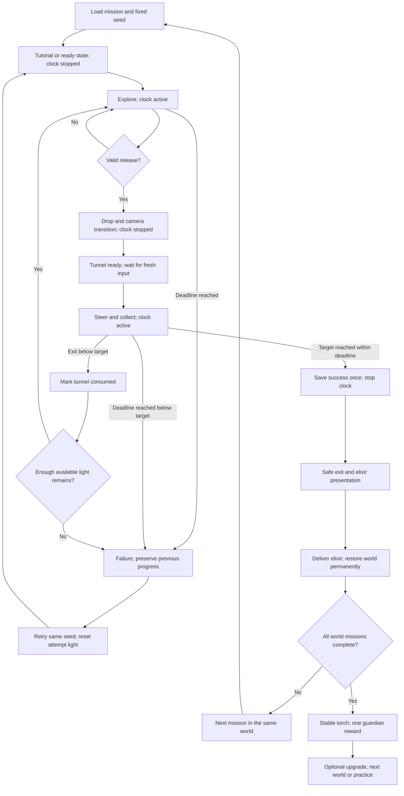
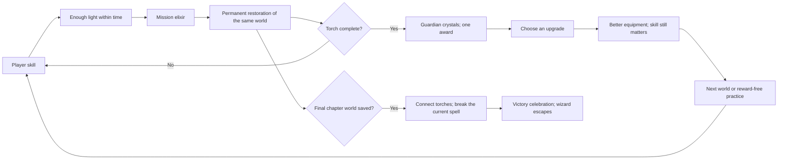

# Light Hunt — Complete Game Scenario and Web Delivery Specification

**Document ID:** LH-GAME-4.1-EN-ONLINE-1  
**Baseline:** Proposed scenario version 4.1, supplied by the owner  
**Language:** English  
**Prepared:** 21 November 2026  
**Companion document:** [Codex phased implementation plan](Light_Hunt_Codex_Phased_Implementation_Plan_EN.md)  
**Status:** Product specification and implementation proposals. This document is not evidence of a completed build, deployment, playtest, or release.

## Read this first

This document has three distinct layers:

1. **Part I:** A complete English rendering of the supplied Persian scenario. It preserves the source's twelve sections, decisions, examples, limitations, references, and two flowcharts.
2. **Part II:** The owner's new delivery requirement: play online through a browser, without installing an application on the player's device.
3. **Part III:** Explicit engineering defaults and requirement identifiers. These make implementation testable. They are additions to the translation, not claims that the source contained those details.

The companion plan controls implementation order. This document controls game behavior. The latest explicit owner instruction takes priority over either document. Do not silently change a product rule to make a test pass.

### Source identity

| Item | Value |
|---|---|
| Exact source file | `Light_Hunt_Scenario_v4_1_FA.md` |
| SHA-256 of supplied source | `abe903942e94266cdd6c731c5045f6e1b75187e6b325f597f2ad3f98547b3d69` |
| Source's own historical basis | `Pasted text.txt`, scenario version 4.0 |
| Source's technical review date | 21 November 2026 |
| Source translation coverage | Introduction; all 12 numbered sections; source references; both Mermaid diagrams |
| New owner requirement | Online browser delivery; no player-side software installation |
| Working title | **Light Hunt** |
| Optional future name | **Nora** remains a proposal, not an approved or legally cleared brand |

**Project context retained from the owner's brief:** The intended audience is age 8 and older. The game targets mobile and desktop browsers. It is a friendly cartoon fantasy, not a horror game. The supplied source discusses this child-facing experience; these audience details also come from the preceding owner brief.

Numbers such as 90 seconds, 22/25/28 lights, and upgrade prices are initial tuning values. They are not proven balance or industry standards. Implementation must start with them, expose them as configuration, and record any later approved change.

---

# Part I — Complete English Scenario, Version 4.1

## Introduction and executive decision

**Review basis:** The source reviewed scenario version 4.0 in `Pasted text.txt`. Story and product decisions came from that document. The more precise rules and deployment method in version 4.1 were review proposals. They had not been implemented or tested with players as part of that review.

**Name:** Keep Light Hunt as the working title. Do not assume that Nora has been approved as the game or character's commercial name.

The core idea remains unchanged: explore darkness, release the firefly, steer horizontally through a tunnel, collect light, make an elixir, restore the world, and receive crystals from its guardian. The main need is not another feature. It is a precise contract for control, time, success, failure, and rewards.

| Decision | Version 4.1 proposal |
|---|---|
| Game technology | TypeScript, Three.js, and Vite; graphics and real-time logic run in the browser |
| Hosting | A small JavaScript function on ArvanCloud Edge serves the entry page and routes requests; assets use Object Storage and CDN |
| MVP | One world, one guardian, three missions, two upgrades, and post-completion practice |
| Removed ideas | Independent zones, hidden-image guessing, fully automatic tunnel collection, and continuing a failed mission after its deadline |
| Deferred ideas | Online cooperation, public leaderboards, real-money purchases, tunnel obstacles, and jumping |
| Review status | Document review and technical research only; no deployment or physical-device test was established by the source review |

### Refined design task

Turn version 4.0 into implementable rules without changing the main product decisions. Define every game state, ending condition, reward, and retry path. Separate browser execution from Edge responsibilities. Support technology claims with official documentation.

GameFlow and MDA are review frameworks for goals, control, feedback, and player experience. They are not a guarantee of success or a global compliance certificate for this game. [B1, B2]

## 1. Review of version 4.0 and proposed corrections

| Original issue | Risk | Version 4.1 correction |
|---|---|---|
| Release and tunnel entry | The player has lifted their finger. The start of the next control mode is unclear. | Use a tunnel-ready state. Require fresh input before forward movement starts. |
| Timed success | The target may be reached inside a tunnel. | Latch success immediately and save a pending result. The exit cinematic cannot cancel it. |
| Result checked only after exit | Time may expire inside a tunnel. | Check time in every active state. |
| Finite light supply | The target may become impossible after opportunities are consumed. | After exit, fail when collected light plus remaining light cannot reach the target. |
| Tunnel repetition | Re-entering could produce unlimited light. | Each tunnel supplies light once per attempt. |
| Randomization after failure | A different layout prevents learning from the last attempt. | Retry with the same seed, paths, and light positions. Vary later missions or a separately requested fresh replay. |
| Guardian reward | Reopening a result screen could duplicate crystals. | Save mission completion IDs and a per-world reward-claimed flag. |
| Upgrade after the only MVP world | The player has no new content in which to use it. | Add practice with new equipment and personal records, without repeated story rewards. |
| Child-facing time pressure | Repeated failure could cause frustration. | Give an untimed tutorial, immediate free retries, and relevant control tips. Do not add lives or mandatory purchases. |
| Edge deployment | It is unclear what runs on the server. | Browser: rendering and control. Edge: HTTP responses and content delivery. |

**Release clarification:** With a fixed hole and a readiness ring, the task is aim-and-release. Do not add an invisible timing window or pixel-perfect reflex requirement. The main timing skill is steering toward lights inside the tunnel.

**Preserved decisions:** Each world is continuous. Every mission restores part of it. Crystals are awarded only after the torch is complete. Failure resets only the current attempt. The ending gives a real victory while the wizard escapes.

## 2. Story and player goals

The Wizard of Darkness has trapped the light of fantasy worlds inside hidden tunnels. The guardians' torches have grown weak. Color, movement, and life have faded into darkness.

One small, playful firefly still carries light. Its mission is to collect light particles and turn them into the **Elixir of Light**. The player guides the firefly, finds holes, releases it over a valid opening, and collects light during tunnel journeys.

Each mission has a time allowance for making one elixir. Collect the required amount before the deadline. The guardian adds the elixir to the torch, and another part of the same world becomes bright again. Each delivery strengthens the torch. After the last mission, the torch becomes stable.

The guardian gives crystals when the world is saved. The player spends them on the firefly's abilities and prepares for the next world. A failed attempt never removes restoration earned in earlier missions.

After all worlds in the story chapter are saved, their torches reveal the wizard's hiding place. The current spell is broken. Saved worlds remain bright. The wizard escapes to an unknown land. The player has fully won the present mission; the sequel does not erase that victory.

| Goal scale | Player objective |
|---|---|
| Immediate | Find a hole and release the firefly correctly. |
| Tunnel | Move horizontally to collect light. |
| Mission | Reach the light target within the active time limit. |
| World | Deliver all required elixirs and stabilize the guardian's torch. |
| Story chapter | Save the worlds and break the wizard's spell. |
| Replay | Improve control, improve a personal record, and try new equipment. |

**Story boundary:** Saved torches do not go out when the player is absent. There is no daily-login obligation to preserve restoration.

### Main loop

Explore → discover a hole → release → steer through the tunnel → collect light → make an elixir → deliver it → restore more of the world → receive crystals when the world is complete → choose an upgrade → continue to another world or practice.

## 3. Controls and interaction contract

| State or event | Player control and game response |
|---|---|
| Exploration | Hold and move a finger, or hold the primary mouse button and move. The firefly follows. Offset its visible position slightly from the finger. |
| Hole ready | A ring and a shape change show valid entry. Do not communicate readiness by color alone. |
| Valid release | Only an intentional touch or primary-click release in a valid area starts the drop. |
| Invalid release | The firefly returns to flight with a short playful response. Do not remove crystals or progress. Active time continues. |
| Camera transition | Disable movement input temporarily. Stop mission time and collection. |
| Tunnel ready | Forward movement has not started. A fresh touch, fresh mouse movement, or a direction key activates control. Do not reuse the preceding input. |
| Active tunnel | Forward movement is automatic. The player controls horizontal movement with mouse, touch drag, or left/right keys. |
| Finger lifted inside a tunnel | Keep the last horizontal position. Forward movement and active time continue. A new touch must not teleport the firefly. |
| Unintentional input loss | `pointercancel` or a hidden page causes a real pause. It is not a release, fall, or gameplay failure. |
| Pause | Freeze the timer, simulation, and collection together. Display a pause overlay. |

Pointer Events and the Page Visibility API provide the relevant browser events. The game must implement and test the behavior itself. [B3, B4]

### Camera rules

Use a fixed, readable angled view for exploration. During the drop, blend to a chase view behind the firefly. In the tunnel, follow the center path rather than every lateral character movement. On exit, restore a clear orientation and return position.

Create excitement through path bends, controlled acceleration, wall motion, and sound. Do not use full camera rolls, compulsory shake, or abrupt field-of-view changes in the MVP. Reduced-motion mode removes extra roll and shake without changing collection rules. XAG 117 supports giving players control over such motion. [B5]

## 4. A complete mission and its timing

**Proposed example:** Forest mission 2; 90 seconds of active time; three tunnels; 36 available lights; target 25. These are initial settings, not playtest results.

| Step | Event |
|---|---|
| Prepare | Load mission assets. Show the 25-light target and the time limit. |
| Start | The player confirms. Enter the dark part of the world and start active time. |
| Discover | Find a hole beside a tree and release after the readiness cue appears. |
| Drop | The camera follows the firefly into the hole. Stop the clock during this forced transition. |
| Tunnel 1 | After fresh input, collect 8 of its 12 lights. |
| Return | Mark the hole as used. It cannot supply more light in this attempt. |
| Tunnel 2 | Collect 9 lights. The total becomes 17. |
| Tunnel 3 | Collect another 8. At active second 73, the total becomes 25. Latch success. |
| Safe exit | Freeze the timer and run a short automatic exit. Count no further light. |
| Deliver | Create the elixir. Save the result before presenting delivery to the guardian. |
| Restore | Light another part of the forest and unlock the next mission. |

### Exact clock rules

Consume active time only in exploration and steerable tunnel movement. Do not consume it during tutorial, loading, tunnel ready, forced camera transitions, pause, or results. Never freeze the timer while leaving reward-producing simulation active.

Timestamp each valid collision. Reaching the target at active time **less than or equal to** the deadline is success. Resolve events within a frame by event time. Rendering order must not invalidate a light collected at the deadline.

When the deadline expires before the target is met, stop input and collection. An exit presentation can still run, but it awards nothing. Do not wait for tunnel exit to check the deadline.

## 5. Success, failure, and fair retry

| Condition | Exact result |
|---|---|
| Target reached in time | Latch success and save a pending delivery immediately. Exit animation cannot change the outcome. |
| Deadline expires below target | End the attempt. Show the shortfall and a retry button. |
| Last tunnel ends below target | Fail immediately instead of waiting for the remaining timer. |
| Target becomes impossible | After a tunnel exit, fail if collected light plus remaining available light is below the target. |
| Return to a consumed hole | Do not allow another light-producing visit. Show a used indicator. |
| Retry | Reuse the same seed, layout, and paths. Reset current-attempt light only. Preserve earlier progress. |
| Close browser during an unfinished attempt | Restart that attempt in the MVP. Preserve completed missions. |
| Close during reward presentation | Recover the saved result without awarding another elixir or crystal reward. |
| Replay a completed mission | Record practice and personal performance. Do not award story elixirs or crystals again. |

### Prevent invalid rounds

Every light has an ID. Count it once per attempt. Every tunnel has a consumed state. All 36 lights must be on paths that base equipment can actually reach. Rendering 36 light objects is not proof that the mission is solvable.

The error allowance must be real. In a 25-of-36 mission, 11 misses are allowed only if path layout and speed still allow collection of the remaining lights.

### Tutorial and help

Use a short untimed tutorial to teach release and lateral steering. Tutorial and separate practice do not generate crystals or elixirs. After failure, show a relevant tip, for example: “Move toward the next light a little earlier.” There are no limited lives, retry fees, or required purchases.

**Save boundary:** MVP progress belongs to the same browser and origin. Clearing browser data or changing device can remove access to the local save. Cloud synchronization is not included. [B6]

## 6. World progression and economy

A world is one continuous environment with several missions. Its main landmarks and guardian remain fixed. Elixir delivery expands permanent illumination. The next mission uses the remaining dark area. These areas have no independent names or guessing puzzles and are not separate zones.

| First-world mission | Active time | Target out of 36 | Proposed restoration |
|---|---:|---:|---|
| 1 | 90 seconds | 22 | About one-third of the world becomes bright. |
| 2 | 90 seconds | 25 | Illumination expands and more objects wake up. |
| 3 | 90 seconds | 28 | The torch becomes stable and the whole world is restored. |

This progression was a new proposal in source version 4.1. Source version 4.0 gave one 25-of-36 example. All missions must remain winnable with base equipment.

| Resource | Purpose | Persistence |
|---|---|---|
| Light particles | Measure the current attempt's collection. | Not carried over from a failed attempt. |
| Elixir | Successful mission result and torch progress; not shop currency. | One grant per story mission. |
| Crystal | Currency for upgrades. | One guardian award per completed world. |

### Proposed shop

Keep the first guardian's proposed reward at **12 crystals**. Purchases happen between missions, not during tunnel movement.

| Upgrade | Initial effect | Initial price | Scope |
|---|---|---:|---|
| Exploration light radius | Increase exploration radius by 10% | 8 crystals | MVP |
| Collection radius | Increase light-collision radius by 10% | 10 crystals | MVP |
| Easier release | Increase the valid entry area by 10% | 6 crystals | Later |
| Colored light trail | Visual change without a skill advantage | Not balanced | Later |
| Consumable attraction wave | Temporary help; needs its own balance | Undefined | Outside MVP |

## 7. Difficulty, motivation, and player experience

| Intended experience | Proposed implementation |
|---|---|
| Curiosity | Limited light and a subtle nearby hole cue. Do not reveal the whole answer at the start. |
| Control | Predictable movement, readable entry area, and lateral steering independent of camera rotation. |
| Excitement | A short drop, curved paths, movement sound, and collectible lights. |
| Mischief and joy | Short character reactions to entry, collection, and missed releases. Never ridicule the player. |
| Progress | A clear counter, visible elixir, stronger torch, and persistent environmental change. |
| Choice | Choose hole order, equipment, and whether to continue or stop. |
| Return motivation | Another world and guardian, another tunnel pattern, and better personal performance. |

These are design hypotheses. GameFlow and MDA help review the connection between rules and experience. They do not prove this game is enjoyable. [B1, B2]

### Difficulty progression

Change one major variable at a time: target count, lateral light spread, or a limited increase in forward speed. Do not simultaneously shrink entry areas, shorten time, and increase speed in the MVP. Camera motion must not become an artificial control penalty.

### Upgrade balance

Enable one level of each of the first two upgrades. Reject unaffordable purchases and repeat purchases of an owned level. Do not add time purchases. Upgrades must not be required to solve an otherwise impossible mission.

### Player skills engaged

Hand-eye coordination, lateral movement adjustment, visual attention, aiming, and learning from a previous attempt. These activities occur in play. Do not claim lasting cognitive benefits outside the game without separate research.

### Motivation after the MVP ending

After the one MVP world is complete, unlock practice with the purchased equipment. Practice may improve personal records but pays no further crystals. A future full release uses the next world as its main continuation. Do not advertise content that is not built.

**Ethical boundary:** No real-money purchases, paid random rewards, open chat, absence penalties, or pressure notifications in the MVP. Return motivation should come from enjoyment, not fear of losing progress.

## 8. Generation, assets, and ending

### Automatic generation method

Compose missions from valid templates. Do not generate unrestricted paths or call a live AI model during play. Preserve the world and its saved restoration. Use a seed to select entrances, tunnel templates, and light patterns.

| Data | Purpose |
|---|---|
| `worldId`, `missionId` | Associate missions with persistent world progress |
| `seed`, `generatorVersion` | Rebuild the same mission and avoid accidental changes after updates |
| `tunnelTemplateIds` | Identify tested three-dimensional paths |
| `entryAnchors`, `exitAnchors` | Valid entry and return locations in the world |
| `lightPatternIds`, `collectibleIds` | Reachable light patterns and duplicate prevention |
| `timeLimit`, `targetLight` | Clock and success contract |
| `restorationId` | Persistent visual effect of one elixir |

Validate entrance reachability, correct exits, lateral spacing against maximum steering speed, camera clearance, and completion within the time budget. Limit generator retries. If generation fails, use a tested fallback layout. A different color or object position does not by itself create a different play experience.

### Minimum assets

One cartoon firefly, one lightweight world, one guardian with torch states, three tunnel templates, light particles, an elixir, a crystal, two upgrade icons, and a few short sounds. Preserve character shape and scale between exploration and tunnels. Do not embed interface text in AI-generated images.

### Full-story ending

After the chapter's final world is saved, connected torchlight reveals the wizard's hiding place. A final mission uses familiar rules to provide the energy needed to break the spell. A short ending shows the guardians' celebration and the wizard's escape. Do not introduce an unrelated combat game at the end.

**The one-world MVP shows that world's ending, not the completion of the entire chapter.** Any wizard scene in it is only a continuation hint. The full ending belongs to the later multi-world campaign.

## 9. Software architecture and camera

### Main technology choice

Use TypeScript, Three.js, and Vite for this project. Vite produces browser files. Three.js handles rendering. Game rules, economy, input, and save logic belong in separate project modules. The current Three.js WebGLRenderer uses WebGL 2, so test device support before starting. [B7, B8]

| Proposed module | Responsibility |
|---|---|
| `game/core` | States, clock, results, rules, and economy; independent of rendering |
| `game/input` | Convert touch, mouse, and keyboard events into commands |
| `game/render` | World, light, character, tunnels, and camera |
| `game/content` | Mission data, templates, seeds, and validation |
| `game/save` | Versioned persistence, recovery, and one-time rewards |
| `ui` | Menus, target, timer, counters, result, and shop |
| `edge` | HTTP entry page, public configuration, and asset routing |
| `tests` | Rules, input, persistence, and deployment checks |

### Tunnel movement

Define a center curve. Tunnel geometry can use `TubeGeometry`. Move by distance along the path rather than by an arbitrary increment of a curve parameter. `getPointAt` supports length-based sampling. [B9, B10]

Apply lateral steering in the tunnel's local coordinate frame. Follow the center path with a camera offset behind the firefly and a look-ahead target. Keep a stable horizon. Blend camera changes. Check movement segments between simulation samples so a low frame rate does not skip lights.

### Persistence and performance

Versioned `localStorage` with error handling is enough for small MVP progress. It is not cross-device sync or anti-cheat security. The initial target is stable 30 FPS on selected test phones, not a guarantee for every phone. [B6]

Use lightweight geometry, compressed or optimized textures, few dynamic lights, no expensive shadow per particle, an adjustable render-resolution cap, and resource disposal when scenes change. Load mission assets before the mission clock starts.

## 10. Proposed ArvanCloud Edge architecture

**Principle:** Render and respond to input in the browser. Edge manages HTTP responses and content delivery. Do not send a network request for every mouse movement or light collision.

| Layer | Runtime and role |
|---|---|
| Game | Browser: Three.js, input, camera, time, and collisions |
| Entry page and configuration | Small JavaScript function on ArvanCloud Edge |
| JavaScript and CSS | Versioned build files with suitable cache rules |
| Models, textures, and sound | ArvanCloud Object Storage through CDN |
| MVP progress | Browser save without an account |
| Possible future online save | A separate authenticated data service, not temporary Edge-function memory |

ArvanCloud documents HTML responses, fixed-origin proxying, routes on a CDN-enabled domain, and Object Storage hosting. Their combination is the proposed architecture, not proof that this game has been deployed. [B11–B14]

### Route contract

Initially, serve the root HTML through Edge. Map asset routes only to an allowlisted, fixed origin. A later optimization can send large files directly through CDN rules to Storage.

Never fetch an arbitrary URL supplied by a visitor. Limit public methods to the required `GET` and `HEAD` routes. Return a real 404 for unknown files. Do not return the HTML application shell for a missing JavaScript file.

When assets use another hostname, test CORS and content types. On the same origin, still test MIME types, cache rules, and versioned paths. All player-facing resources must use HTTPS.

### Do not assume

Do not assume complete Node.js support, a built-in database, Cloudflare-style KV, Wrangler configuration, or Cloudflare limits on ArvanCloud. Node.js is a development/build tool in this design, not the permanent game server. Verify the account's function size, CPU, memory, response, request, and cost limits.

**Storage or CDN hosting alone is not Edge-function execution.** The entry page must really be served through Edge. If event eligibility matters, obtain current organizer confirmation for the hybrid architecture. Do not infer acceptance from technical feasibility.

## 11. Build and deployment sequence in the source

| Source step | Verifiable output |
|---|---|
| Control and camera slice | One hole and one tunnel; entry, lateral steering, and exit on a real phone |
| Mission logic | Active clock, target, once-only collection, and same-seed retry |
| World progress | One elixir per mission and permanent restoration |
| Economy | One-time guardian reward, two upgrades, and equipment practice |
| Edge proof | Real HTTPS delivery of HTML, JavaScript, and one small model |
| Final build | Separate browser and Edge artifacts; dependency lockfile |
| Staging | Hosted files and function, with cache, error, and recovery checks |
| Approved release | The tested artifact, a deployment identity, and a rollback path |

The operational companion expands these steps into smaller phases and brings a small Edge feasibility check forward. It does not change game scope.

Vite's default build output is `dist`. `vite preview` is a local preview, not a production server. Do not upload the browser output as though it were the Edge-function program. [B8]

ArvanCloud documents panel/CLI creation and Deployment IDs. Use the panel for the first verified deployment unless the actual CLI is already understood. Verify any automation against the installed official tool and current documentation. Do not copy another provider's commands. [B15]

### Cache and release contract

HTML and the current-release pointer must allow update checks. Use long-lived cache rules for content-hashed files. Upload and verify all assets first, then switch HTML/Edge configuration to that release. Retain previous release assets. Measure real cache behavior.

### AI-assisted development

Each coding request must define one bounded feature and its acceptance criteria. Separate logic from rendering. After a change, run the relevant build and tests and record actual results. File existence or a successful build is not product acceptance.

Keep setup in README, rules in the product specification, technical decisions in the architecture record, and agent boundaries in a small repository guide. Never store secrets in client files or the repository. Public deployment, spending, and cloud-account changes require specific authorization. ArvanCloud documents server-side encrypted environment values. [B16]

## 12. Acceptance criteria and open issues

| Test | Expected result |
|---|---|
| Valid and invalid release | Only a valid release starts a drop; an error preserves prior progress. |
| Control handoff | No teleport or immediate missed light on tunnel entry. |
| Last light at the deadline | In-time collision succeeds; a later one does not count. |
| Deadline inside tunnel | Close the attempt there, not only after exit. |
| Duplicate light | Count each ID at most once per attempt. |
| Exhausted opportunity | Never leave an impossible round running indefinitely. |
| Retry | Same seed and difficulty; only attempt data resets. |
| Result reload | Do not duplicate elixir or guardian crystals. |
| Purchase | No negative balance or duplicate upgrade level. |
| Pause/resume | Freeze and resume input, simulation, and clock together. |
| Generation | Sampled seeds have reachable light and sufficient time with base equipment. |
| Hosting | HTML, JavaScript, model, and sound load by HTTPS with correct content types. |
| Infrastructure error | Missing assets, upstream failure, and connection loss have clear recovery messages. |
| Rollback | The previous game works with its own previous assets. |

An initial automatic sample of 1,000 seeds is proposed. Automatic validation does not replace human testing of control, motion comfort, learning, or voluntary replay.

### Player testing

In a small initial test, observe whether players understand the controls and failure reason, choose to retry, and want to continue after restoring the world. Use it to find problems, not to claim statistical proof of success.

### Unverified items

Threshold and price balance, collision radius, tunnel speed, target-phone performance, final accessibility, ArvanCloud account quotas, and event acceptance remain unverified. The source review did not reopen the event page, so its deadline and full rules were not reconfirmed. This document does not validate that historical event status.

**Historical review delivery:** Revised text, proposed architecture, and clean diagrams. The source review did not change a repository, cloud account, live service, or running game. Creating this English document also does not establish that any implementation phase has passed.

## Baseline sources and decision trace

The source version 4.1 traced its product decisions to `Pasted text.txt`, scenario version 4.0. Preserve that history. The following references are carried over from the supplied source, rather than presented as new performance or compliance evidence.

- **B1:** [Sweetser and Wyeth — GameFlow, 2005](https://doi.org/10.1145/1077246.1077253).
- **B2:** [Hunicke, LeBlanc, and Zubek — MDA, 2004](https://aaai.org/papers/ws04-04-001-mda-a-formal-approach-to-game-design-and-game-research/).
- **B3:** [MDN — Pointer Events](https://developer.mozilla.org/en-US/docs/Web/API/Pointer_events).
- **B4:** [MDN — Page Visibility API](https://developer.mozilla.org/en-US/docs/Web/API/Page_Visibility_API).
- **B5:** [Microsoft — Xbox Accessibility Guideline 117](https://learn.microsoft.com/en-us/xbox/accessibility/xbox-accessibility-guidelines/117).
- **B6:** [MDN — localStorage](https://developer.mozilla.org/en-US/docs/Web/API/Window/localStorage).
- **B7:** [Three.js — WebGLRenderer](https://threejs.org/docs/pages/WebGLRenderer.html).
- **B8:** [Vite — Static deployment](https://vite.dev/guide/static-deploy).
- **B9:** [Three.js — TubeGeometry](https://threejs.org/docs/pages/TubeGeometry.html).
- **B10:** [Three.js — Curve](https://threejs.org/docs/pages/Curve.html).
- **B11:** [ArvanCloud — Return HTML](https://docs.arvancloud.ir/fa/edge-computing/examples/return-html/).
- **B12:** [ArvanCloud — Fixed-origin proxy](https://docs.arvancloud.ir/fa/edge-computing/examples/origin-proxy/).
- **B13:** [ArvanCloud — Edge routes](https://docs.arvancloud.ir/fa/edge-computing/trigger/path/).
- **B14:** [ArvanCloud — Object Storage website](https://docs.arvancloud.ir/fa/object-storage/buckets/static-website/).
- **B15:** [ArvanCloud — Edge dashboard](https://docs.arvancloud.ir/fa/edge-computing/dashboard/).
- **B16:** [ArvanCloud — Environment variables](https://docs.arvancloud.ir/fa/edge-computing/env-variables/).

### Baseline diagram 1 — Mission

### Baseline diagram 2 — Economy and progression

---

# Part II — New Owner Requirement: Online, No Installation

This part adds the owner's latest instruction. It does not change the story or economy above.

## 13. Delivery contract

**The player opens an HTTPS URL in a supported browser and plays there. No app installation is required or offered by the product.**

| Requirement | Interpretation |
|---|---|
| Online access | Serve the game from the hosted site. Do not distribute a downloadable HTML file as the production play method. |
| No software installation | No APK, IPA, EXE, desktop wrapper, launcher, browser extension, native plugin, Python runtime, Node.js, or terminal steps for players. |
| No installable/offline product | Do not add PWA install prompts, an application-install manifest, a service worker, or an offline-download mode in the MVP. |
| Browser execution | The browser still receives and executes JavaScript and loads assets. This is ordinary web delivery, not a native application install. |
| Browser cache | Normal browser HTTP caching is allowed. Do not promise that zero bytes reach or remain on the device. |
| Local progress | Small local save data remains allowed under the source's MVP save contract. Data storage is not executable software installation. |
| Single-player online | “Online” means web-hosted access. It does not add multiplayer, cloud saves, accounts, or remote video streaming. |
| Development tools | Vahid and Codex may use a development toolchain. End users must not need it. |

Browsers load page resources from servers and execute client code. `localStorage` is origin-specific browser data, not a cloud account. [N1, B6]

A requirement that **no game code may execute or be received by the device at all** would require a different product architecture, such as remote rendering and streaming. That is not the selected architecture and must not be claimed here.

## 14. Online access and interruption policy

The following are explicit implementation defaults, not details present in the Persian source:

1. Before a new mission or practice attempt, perform a fresh, uncached request to the game's own small connectivity endpoint. Use a bounded timeout. Do not run the mission clock while loading or checking.
2. Start only after required assets are ready and the connectivity check succeeds. A failed check shows a retry message. It is not a failed mission.
3. Do not send movement, collision, or frame-by-frame updates to Edge. No multiplayer server or persistent socket is needed.
4. Treat browser online/offline events as hints. Verify access to the actual game endpoint before declaring service availability. `navigator.onLine` is not a reliable internet test. [N2]
5. On a detected connectivity problem during an attempt, pause input, simulation, and time together. Preserve the in-memory attempt. Allow an explicit retry and resume after the service is reachable.
6. A fully loaded attempt can briefly continue before a connection failure is detected. This MVP does not provide continuous connectivity enforcement or anti-tamper protection. Do not promise immediate detection or add per-frame polling.
7. A saved successful outcome remains successful even if a later network check fails. Retry connectivity or result presentation without granting the reward twice.
8. After a reload, an unfinished attempt restarts from its recorded seed. A completed outcome recovers from the save, subject to browser-storage availability.
9. No offline menu option or offline installation is shipped. Returning players use the hosted URL again.

**Proposed route:** `GET /health` returns a small no-store response. The exact path may change in the architecture record. It must not contain player identity or be misrepresented as a cloud-save API.

## 15. Delivery completion definition

Delivery is complete only when a new player can open the approved production HTTPS URL in a clean supported browser, play the full one-world MVP, close and reopen it, and see locally saved progress without installing anything.

A local build, a video, an HTML download, a mocked Edge handler, or a desktop-only browser run does not satisfy this condition.

Infrastructure outages, unavailable storage, unsupported graphics, or asset failures must give a clear message. They must not be reported as player skill failures.

---

# Part III — Explicit Implementation Defaults and Requirement Index

These details close implementation gaps. Keep them separate from the translated baseline. They may be refined through tested engineering decisions, but product changes need owner approval.

## 16. Scope lock

| In the first release | Not in the first release |
|---|---|
| One continuous fantasy forest and one guardian | Multiple completed worlds or a full chapter ending |
| Three missions, each with three tunnel opportunities | Independent zones or image-guessing puzzles |
| Three tested tunnel templates and seeded light patterns | Arbitrary AI-generated geometry during play |
| Horizontal tunnel steering and actual collision collection | Automatic collection of all lights |
| 90-second active-time contract | An optional-speed-bonus timer that allows failed attempts to continue |
| 22/25/28 targets out of 36 | Time purchases, lives, retry fees |
| Elixirs, restoration, 12-crystal guardian reward | Crystals on every tunnel or every replay |
| Two one-level upgrades and practice | Live chat, social matchmaking, public ranking, payments |
| Hosted HTTPS browser game | Native binaries, PWA/offline installer, cloud-video streaming |
| Local save with explicit limitations | Cloud synchronization or anti-cheat guarantees |

## 17. Player-facing screens and visual direction

Use a cartoon firefly with a friendly face and a warm small light. The world is mysterious, not threatening. Use soft warm light against a cool dark environment. The reveal is colorful and lively. These visual directions consolidate the baseline's cartoon world and emotional goals; they are not a separate visual asset pack.

| Screen/state | Required content |
|---|---|
| Loading/compatibility | Loading state, graphics support, network retry, and no installation request |
| Main menu | Play/Continue, tutorial, settings, and a truthful local-save notice |
| Mission briefing | Mission number, target, time limit, and Start |
| Exploration HUD | Light count/target, remaining active time, pause, and readable hole cues |
| Tunnel ready | Short “Move to start” instruction appropriate to the input method |
| Tunnel HUD | Same time and target; no shop overlay |
| Failure | Collected count, target, clear failure reason, Retry, and Menu |
| Success/delivery | Elixir, guardian response, and restoration; saved before presentation |
| World complete | Stable torch, full reveal, once-only crystal award, and optional shop |
| Shop | Current balance, exact effect, price, owned state, and confirmation feedback |
| Practice | Completed-mission choice, equipment loadout, and “No story rewards” label |
| Settings | Sound, reduced camera motion, and control sensitivity |

**UI implementation default:** Portrait-first mobile layout. Adapt to desktop and orientation changes without hiding targets. Use real text, localization keys, and logical CSS properties. Do not assume that English specification language determines the final game language. Prepare Persian RTL and English LTR support; the initial visible language can be confirmed during the UI review.

Use distinct shape/state cues for entry readiness, used holes, and collection. Do not rely only on color or sound. Keep essential controls large and separated. The test target is at least 48 CSS pixels for primary buttons; this is a project target, not a claim about a mandatory global standard.

## 18. State, event, and control details

| State | Active clock | Collection | Main exit |
|---|---|---|---|
| `LOADING` / `BRIEFING` / `TUTORIAL` | No | Tutorial only, not story credit | Explicit start |
| `EXPLORE` | Yes | No | Valid release, deadline, or pause |
| `DROP_TRANSITION` | No | No | Transition complete |
| `TUNNEL_READY` | No | No | Fresh control input |
| `TUNNEL_ACTIVE` | Yes | Yes | Target, deadline, tunnel end, or pause |
| `EXIT_TRANSITION` | No | No | Opportunity check, then explore |
| `SUCCESS_PENDING` / `SUCCESS_EXIT` | No | No | Saved result presentation |
| `FAILURE` | No | No | Same-seed retry or menu |
| `DELIVERY` / `WORLD_RESTORE` | No | No | Next mission or world complete |
| `WORLD_COMPLETE` / `SHOP` | No | No | Practice or menu |
| `PAUSED` / `NETWORK_WAIT` | No | No | Explicit safe resume |

`PRACTICE` is a mode, not a second game engine. It uses the same clock, steering, collision, and terminal rules. It has no story or currency grants.

### Input details

- Own one active pointer. Secondary touches cannot steer or release the firefly.
- Begin exploration dragging only on the playfield, never through a UI button.
- Capture the active pointer when appropriate. Clear ownership on cancellation and pause.
- Use a fresh relative input baseline at tunnel entry and touch re-entry. The first sample establishes control, not an absolute jump.
- Map lateral input to the tunnel-local right axis. Limit position and lateral speed. Mouse users must not teleport between distant lights.
- Add keyboard-equivalent steering. For exploration, arrow keys move and an explicit key releases. This is an accessibility default, not a new scoring rule.
- Resume only after the player dismisses the pause state. Clear stale held-key and pointer states.
- On resize, preserve logical character position and rebase input. Do not convert resize into release.

### Timing and collisions

Use a monotonic active-time clock and bounded simulation steps. Do not make a slow device receive more time by silently discarding elapsed active time. Freeze real pauses deliberately. Resolve the deadline and continuous collision times in the same simulation time domain.

Process valid collection events up to and including the deadline. Once success is latched, ignore subsequent collection and failure events. Once failure is latched, ignore subsequent collection. A terminal state occurs once.

Use swept collision checks or a verified equivalent. Test lights at the exact deadline, just before it, and just after it under different frame schedules.

## 19. Data and save contracts

These are conceptual records, not a requirement to copy a particular class structure.

| Record | Minimum fields |
|---|---|
| World definition | `worldId`, guardian, ordered mission IDs, restoration effects, completion reward |
| Mission definition | `missionId`, `worldId`, `timeLimitMs`, `targetLight`, three tunnel instances, `restorationId` |
| Generated mission | seed, generator/content versions, chosen templates, exact light IDs and positions, anchors, manifest hash |
| Tunnel instance | Unique ID, template ID, entry/exit anchor, length, width, speed profile, 12 collectible definitions |
| Collectible | Unique ID, path distance, lateral position, radius, value 1 |
| Attempt | ID, mission identity, mode, loadout snapshot, active time, collected IDs, consumed tunnel IDs, state, pending outcome |
| Durable profile | Schema version, completed mission IDs, restored effects, world reward claims, crystal balance, owned upgrades, settings, assigned mission seeds/manifests, pending presentation, practice records |

### Save integrity

Persist a successful mission as one validated transition. Derive its elixir/restoration from the completed mission ID; do not maintain unprotected duplicate counters. Store pending presentation so reload can resume celebration without re-granting progression.

Grant the guardian's 12 crystals in the same save transition that records its claim, or in an equally crash-safe idempotent operation. The last elixir may trigger that operation; the visible ceremony does not control financial state.

Validate save shape, schema version, known IDs, nonnegative integer balance, and owned upgrade levels. Handle storage exceptions visibly. A memory-only fallback may allow a session but must state that progress will not survive closing the page.

Unknown future save versions must not be silently overwritten. Keep migration and rollback compatibility explicit. Do not automatically erase progress to repair a problem.

For the first release, support one active gameplay tab per profile. Detect competing sessions and make a second tab read-only or paused. Do not claim that localStorage provides server-grade transactions or cheat resistance.

### Replay identity

A retry keeps seed, generator version, and content version. Save the assigned mission identity before starting its first attempt so reload can reconstruct it. Snapshot equipment at attempt start. An immediate retry retains that snapshot; changing equipment requires leaving the attempt and starting a new run from the briefing. A practice run can compare records only against a compatible mission, seed, rules, and loadout. Do not compare a heavily assisted run with base-equipment performance as though they were identical.

**New practice-presentation default:** Since the world is fully bright after completion, practice may temporarily show the selected mission's original darkness as a clearly labeled training view. This lets the player test the exploration-radius upgrade. It must never change saved restoration or suggest that the guardian lost the world. On leaving practice, show the permanently restored world again. Practice uses the same target and time rules, with no story-resource grants.

### Economy example

After the first world, the player has 12 crystals. Buying the 8-crystal radius upgrade leaves 4. Buying the 10-crystal collection upgrade instead leaves 2. Both cannot be purchased with that first reward. This is the baseline's bounded choice, not a reason to add farming, advertisements, or payments.

## 20. Requirement index for the operational plan

| ID | Binding behavior | Source |
|---|---|---|
| G01 | One continuous world; missions restore it; no zones or guessing | Part I §§2, 6 |
| G02 | One guardian, three missions, two upgrades in MVP | Introduction, Part III §16 |
| G03 | Hold/move in exploration; limited light; readable hole readiness | Part I §3 |
| G04 | Intentional valid release only; invalid release preserves progress | Part I §3 |
| G05 | Smooth chase-camera entry and clear exit | Part I §3 |
| G06 | Fresh tunnel input; no position jump | Part I §3 |
| G07 | Automatic forward movement, player-controlled horizontal movement | Part I §3 |
| G08 | Actual collision collection; unique particles; one use per tunnel | Part I §5 |
| G09 | Clock runs only during active exploration and steerable travel | Part I §4 |
| G10 | Target at or before deadline succeeds; terminal result is immutable | Part I §§4–5 |
| G11 | Deadline and impossible-target failure are handled without endless rounds | Part I §5 |
| G12 | Same-seed retry; previous permanent progress survives | Part I §5 |
| G13 | One elixir/restoration grant per story mission | Part I §6 |
| G14 | One 12-crystal reward after all world missions | Part I §6 |
| G15 | Radius upgrade 8; collection upgrade 10; 10% each; one level | Part I §§6–7 |
| G16 | Practice gives no repeated elixirs or crystals | Part I §§5, 7 |
| G17 | Validated seeded content, stable versioning, tested fallback | Part I §8 |
| G18 | Untimed tutorial, free retry, no lives or mandatory purchase | Part I §5 |
| G19 | Pause freezes simulation, clock, and collection together | Part I §3 |
| G20 | Reduced motion and readable, non-color-only feedback | Part I §3 |
| G21 | Cartoon character, playful reactions, gradual visual restoration | Part I §§2, 7–8 |
| G22 | Target 30 FPS on selected physical phones; measure it | Part I §9 |
| G23 | Typed browser architecture; no per-frame network dependency | Part I §§9–10 |
| G24 | Versioned local save; transparent loss and security limits | Part I §§5, 9 |
| G25 | HTTPS entry through real Arvan Edge; versioned assets through Storage/CDN | Part I §10 |
| G26 | Allowlisted routes/origins, proper errors/MIME/cache, no exposed secrets | Part I §§10–11 |
| G27 | Separate artifacts, verified release identity, retained rollback assets | Part I §11 |
| G28 | No out-of-scope mechanics or forced login/spending systems | Introduction, Part I §7 |
| G29 | Chapter ending preserves victory; MVP does not claim chapter completion | Part I §8 |
| G30 | Online browser play without native/PWA installation | Part II §13 |
| G31 | Online readiness and recoverable connection interruption | Part II §14 |
| G32 | Failed infrastructure is not failed player skill | Part II §§14–15 |
| G33 | Exact deployed build must pass real-browser and device acceptance | Part I §12, Part II §15 |

## 21. New research notes and limits

The following facts were checked for preparation of this pair of documents. They support implementation advice, not claims of game completion:

- **N1:** [MDN — How the web works](https://developer.mozilla.org/en-US/docs/Learn_web_development/Getting_started/Web_standards/How_the_web_works): browser delivery requires receiving page resources. See also [MDN — What is JavaScript?](https://developer.mozilla.org/en-US/docs/Learn_web_development/Core/Scripting/What_is_JavaScript) for client-side execution.
- **N2:** [MDN — Navigator.onLine](https://developer.mozilla.org/en-US/docs/Web/API/Navigator/onLine): the browser online flag is only a heuristic.
- **N3:** [OpenAI — Repository instructions with AGENTS.md](https://developers.openai.com/codex/guides/agents-md): use a short persistent entry point. Large specifications are explicitly read supporting documents, not a reason to paste everything into AGENTS.md.
- **N4:** [OpenAI — Iterating development workflows with Codex](https://developers.openai.com/cookbook/examples/codex/iterating-development-workflows-with-codex): persistent context, scoped work, and observed verification support phased development.

For implementation, recheck current supported package versions and the actual ArvanCloud account capabilities. The source's product rules remain the basis. No repository or production service was changed while preparing these documents.
